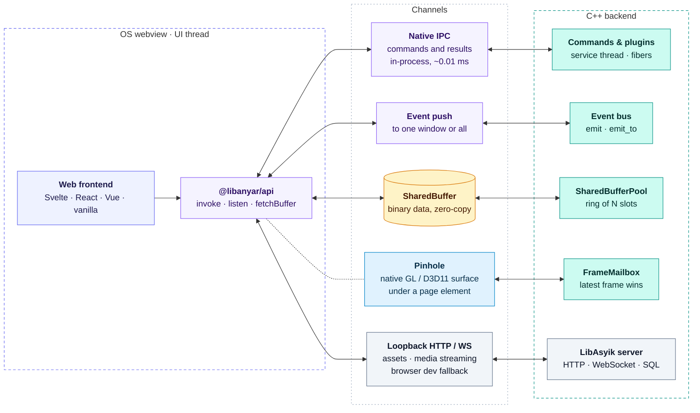
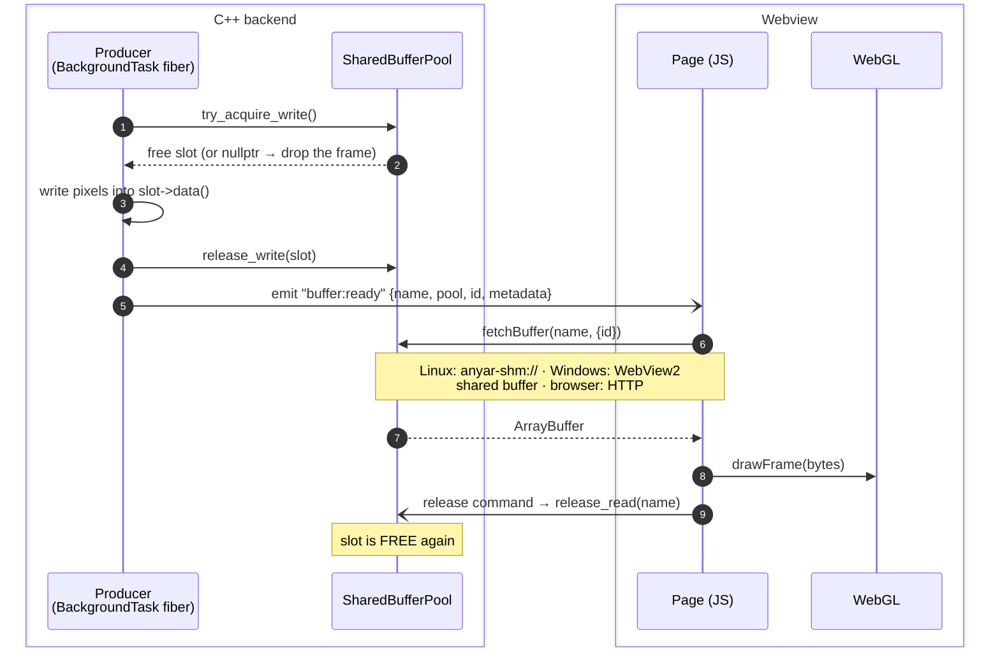
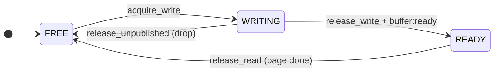
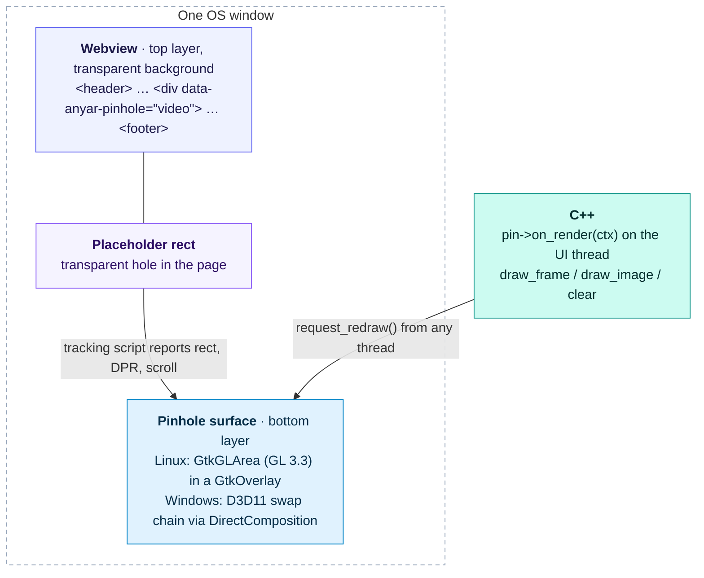
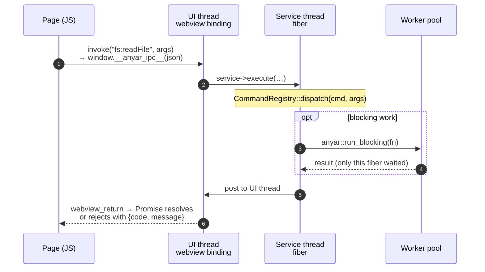
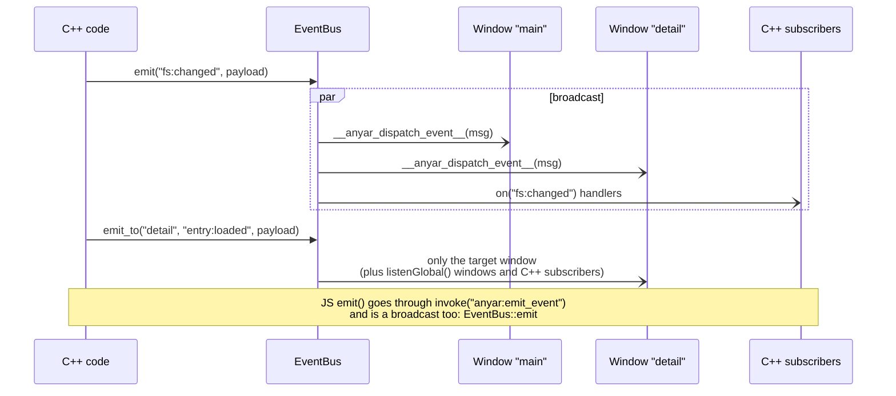
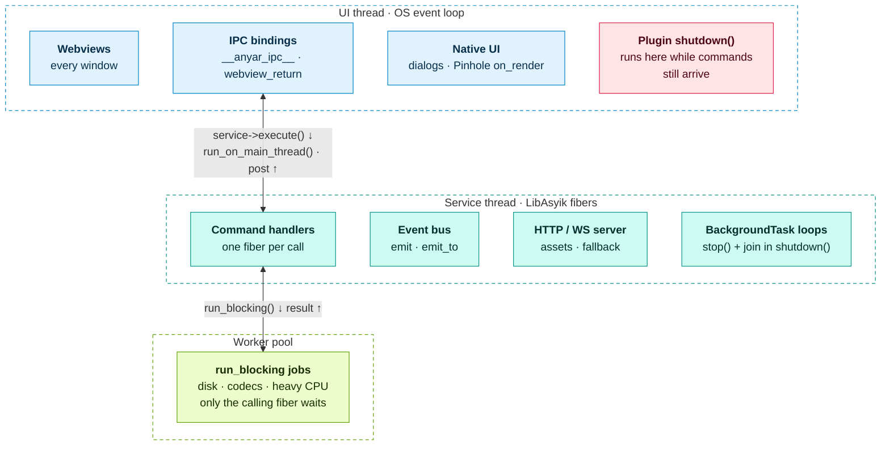

# LibAnyar — Architecture Document

> Last updated: 2026-10-30

## Table of Contents

1. [Overview](#overview)
2. [System Architecture](#system-architecture)
3. [Component Details](#component-details)
   - [Window Behavior — Native App Feel](#5a-window-behavior--native-app-feel)
   - [Shared Memory IPC & WebGL Canvas](#2d-shared-memory-ipc-channel-binary-data)
   - [Pinhole Native Overlay](#2e-pinhole-native-overlay-linux-windows)
   - [Shutdown Sequence](#shutdown-sequence)
4. [IPC Protocol](#ipc-protocol)
5. [Threading & Concurrency Model](#threading--concurrency-model)
6. [Platform Abstraction](#platform-abstraction)
7. [Dependency Map](#dependency-map)
8. [Directory Structure](#directory-structure)
9. [Security Model](#security-model)

---

## Overview

LibAnyar is a C++17 desktop application framework that combines:
- **OS-native webviews** for rendering web-based UI (React, Vue, Svelte, etc.)
- **Native IPC** via `webview_bind`/`webview_return` for Tauri-class command latency (~0.01ms)
- **LibAsyik** as the core runtime for HTTP serving, WebSocket fallback, SQL database access, and fiber-based concurrency
- **Zero-copy shared memory IPC** for high-throughput binary data: POSIX `shm_open` + `anyar-shm://` on Linux, WebView2 shared buffers on Windows
- **Thin native API wrappers** for platform features (dialogs, tray, clipboard, etc.)

### Design Principles

1. **Leverage, don't rewrite** — Use LibAsyik for everything it provides; only build what's missing
2. **OS webview, not bundled browser** — Keep binary size small (3-8MB)
3. **Native-first IPC** — In-process `webview_bind`/`webview_return` as primary channel; HTTP/WS as fallback for dev/browser mode
4. **Fiber-first concurrency** — Synchronous-looking async code via Boost.Fiber
5. **Convention over configuration** — Sensible defaults, minimal boilerplate
6. **Plugin-extensible** — Core stays lean; features added via plugins

---

## System Architecture

LibAnyar is four layers. Your frontend calls `@libanyar/api`; the OS webview hosts it on the UI thread; the C++ core runs commands, events and data paths on one service thread plus a worker pool; LibAsyik provides the fibers, HTTP server and SQL underneath.

```mermaid
flowchart TB
  subgraph L1["Frontend · your Vite app"]
    direction LR
    A1["<b>Core</b><br/>invoke · listen · emit"]
    A2["<b>Native APIs</b><br/>fs · dialog · shell · clipboard · db"]
    A3["<b>Windows</b><br/>createWindow · emitTo"]
    A4["<b>Binary & rendering</b><br/>buffer · canvas · pinhole"]
    A5["<b>Debug</b><br/>debug · anyarTest"]
  end
  subgraph L2["OS webview · UI thread"]
    direction LR
    W1["<b>Linux</b><br/>WebKitGTK 4.0<br/>anyar-shm:// scheme · GL pinhole"]
    W2["<b>Windows</b><br/>WebView2<br/>shared buffers · D3D11 pinhole"]
    W3["<b>macOS</b><br/>WKWebView<br/>planned"]
  end
  subgraph L3["LibAnyar core · C++17"]
    direction LR
    C1["<b>anyar::App</b><br/>config · lifecycle · run()"]
    C2["<b>IPC</b><br/>CommandRegistry · IpcRouter"]
    C3["<b>EventBus</b><br/>window sinks · WS · C++ subs"]
    C4["<b>WindowManager</b><br/>multi-window · modal"]
    C5["<b>Plugins</b><br/>IAnyarPlugin · built-ins"]
    C6["<b>Data paths</b><br/>SharedBuffer · Pool<br/>FrameMailbox · Pinhole"]
    C7["<b>Concurrency</b><br/>run_blocking · BackgroundTask<br/>run_on_main_thread"]
    C8["<b>Debug tools</b><br/>console · capture · input"]
  end
  subgraph L4["LibAsyik · foundation"]
    direction LR
    F1["<b>Fibers</b><br/>Boost.Fiber · Asio"]
    F2["<b>HTTP / WS</b><br/>server · client"]
    F3["<b>SQL</b><br/>SOCI · SQLite · Postgres"]
    F4["<b>Utilities</b><br/>logging · rate limit · cache"]
  end
  L1 -- "@libanyar/api" --> L2
  L2 -- "native IPC · events · buffers" --> L3
  L3 --> L4
  class A1,A2,A3,A4,A5 ui
  class W1,W2 native
  class W3 base
  class C1,C2,C3,C4,C5,C6,C7,C8 core
  class F1,F2,F3,F4 base

  classDef ui fill:#eef2ff,stroke:#6366f1,color:#1e1b4b
  classDef bridge fill:#f5f3ff,stroke:#8b5cf6,color:#2e1065
  classDef native fill:#e0f2fe,stroke:#0284c7,color:#082f49
  classDef core fill:#ccfbf1,stroke:#0d9488,color:#042f2e
  classDef data fill:#fef3c7,stroke:#d97706,color:#451a03
  classDef base fill:#f1f5f9,stroke:#64748b,color:#0f172a
  classDef work fill:#ecfccb,stroke:#65a30d,color:#1a2e05
  classDef warn fill:#ffe4e6,stroke:#e11d48,color:#4c0519
  style L1 fill:transparent,stroke:#6366f1,stroke-dasharray:5 4
  style L2 fill:transparent,stroke:#0284c7,stroke-dasharray:5 4
  style L3 fill:transparent,stroke:#0d9488,stroke-dasharray:5 4
  style L4 fill:transparent,stroke:#64748b,stroke-dasharray:5 4
```



The two halves talk over five channels, each suited to one kind of traffic:



---

## Component Details

### 1. `anyar::App` — Application Lifecycle

Central entry point. Owns the LibAsyik service, HTTP server, and window manager.

```cpp
class App {
public:
    App();
    explicit App(AppConfig config);

    // Command registration
    void command(const std::string& name, CommandHandler handler);
    void command_async(const std::string& name, AsyncCommandHandler handler);

    // Event system
    void emit(const std::string& event, const json& payload = json::object());
    void emit_to(const std::string& label, const std::string& event, const json& payload = json::object());
    UnsubscribeFn on(const std::string& event, EventHandler handler);

    // Window management
    void create_window(WindowConfig config = {});
    void create_window(WindowCreateOptions opts);
    WindowManager& window_manager();

    // Plugin system
    void use(std::shared_ptr<IAnyarPlugin> plugin);

    // Custom HTTP routes (always take priority over serve_static)
    void http_get(const std::string& path, RouteHandler handler);
    void http_post(const std::string& path, RouteHandler handler);

    // Local file access via anyar-file:// (path traversal rejected)
    void allow_file_access(const std::string& directory);

    // Lifecycle hooks
    void on_ready(ReadyCallback cb);                // server + plugins initialized
    void on_window_ready(WindowReadyCallback cb);   // main thread, main Window exists,
                                                    // GTK loop not yet running (create_pinhole here)

    asyik::service_ptr service() const;
    anyar_http_server_ptr server() const;
    int port() const;

    // Serve the frontend from memory (e.g. anyar::make_embedded_resolver())
    void set_frontend_resolver(FileResolver resolver);

    // Run the application (blocks until the main window closes; owns shutdown order).
    // Returns the exit code (non-zero from a test script via ANYAR_TEST_SCRIPT).
    int run();
};
```

### 2. IPC Router — Hybrid Architecture

LibAnyar uses a **hybrid IPC model** inspired by Tauri: in-process native
IPC as the primary channel (near-zero latency), with HTTP/WebSocket kept
as a fallback for browser-based development and content streaming.

#### 2a. Native IPC Channel (Primary — in webview)

**Commands** — `webview_bind` / `webview_return`:
- C++ calls `window_->bind("__anyar_ipc__", callback)` at startup
- JS calls `await window.__anyar_ipc__(json)` → returns a Promise
- Callback runs on the **UI thread** (GTK on Linux, Win32 on Windows), dispatches work to a
  LibAsyik fiber via `service_->execute()`, then dispatches the result
  back to the UI thread via `window_->dispatch()` + `window_->return_result()`
- Latency: ~0.01–0.1 ms (in-process, no TCP/HTTP overhead)

**Events** — `webview_eval` push:
- C++ registers a labeled window sink via `EventBus::add_window_sink(label, sink)`
- When a broadcast event fires, all sinks receive `window_->eval("window.__anyar_dispatch_event__(msg)")`
- Targeted events via `EventBus::emit_to_window(label, event, payload)` — only the target window’s sink is called
- JS `listen()` filters by target: events aimed at other windows are ignored
- JS `listenGlobal()` receives all events (broadcast + other windows’ targeted events) via `set_global_listener()`
- JS → C++ events use `invoke('anyar:emit_event', {event, payload})` which calls `EventBus::emit()` (broadcast)
- JS → targeted: `invoke('anyar:emit_to_window', {label, event, payload})` calls `EventBus::emit_to_window()`

**Detection**: JS bridge checks `typeof window.__anyar_ipc__ === 'function'`
and the C++ side injects `window.__LIBANYAR_NATIVE__ = true` via `webview_init()`.

#### 2b. HTTP/WebSocket Channel (Fallback — browser dev mode)

**HTTP POST Channel** (`/__anyar__/invoke`):
- Request-response pattern
- Used by `invoke()` when native IPC is unavailable (e.g., `vite dev` in browser)
- Payload: `{"cmd": "name", "args": {...}, "id": "uuid"}`
- Response: `{"id": "uuid", "data": {...}, "error": null}`

**WebSocket Channel** (`/__anyar_ws__`):
- Bidirectional event streaming
- Used by `listen()` and `emit()` when not inside a webview
- Backend → Frontend: `{"type": "event", "event": "name", "payload": {...}}`
- Frontend → Backend: `{"type": "event", "event": "name", "payload": {...}}`
- One WebSocket per window, managed as a fiber

#### 2c. HTTP Server (Always Active)

The LibAsyik HTTP server remains active regardless of IPC mode:
- **Static file serving** (`serve_static("/")`) — serves the bundled frontend `dist/`
- **Content streaming** — video/audio with `Range` header support
- **Plugin HTTP routes** — any plugin that needs raw HTTP (e.g., thumbnail endpoints)

#### 2d. Shared Memory IPC Channel (Binary Data)

For high-throughput binary data (video frames, images, point clouds), LibAnyar provides a **zero-copy shared memory** channel that bypasses JSON serialization entirely.

**Architecture:**



**SharedBuffer** — Named shared memory region:
- Created via `buffer:create` command (IPC) or `SharedBuffer::create()` (C++)
- Linux: POSIX `shm_open("/anyar_<pid>_<name>")` + `mmap()`. Windows: a WebView2 shared buffer once a window exists (the page pulls it with `buffer:attach`, ADR-011), otherwise a pagefile-backed mapping served over HTTP
- C++ writes directly to `buf->data()` (raw pointer), JS reads via `fetchBuffer(name)`
- **Native webview**: `anyar-shm://` custom URI scheme (zero-copy via `g_bytes_new_with_free_func()` holding a `shared_ptr` to the buffer)
- **Browser dev mode**: HTTP GET `/__anyar__/buffer/<name>` endpoint (copy, but works in any browser)
- `fetchBuffer()` auto-detects runtime via `isNativeIpc()` and selects the appropriate path
- CORS-enabled: `webkit_security_manager_register_uri_scheme_as_cors_enabled()`

**SharedBufferPool** — Lock-free ring buffer for streaming:
- Fixed-size pool of N slots for double/triple buffering
- Atomic state per slot, `compare_exchange_strong`, no mutex in the hot path:



- `try_acquire_write()` returns `nullptr` when every slot is busy (drop the frame); `acquire_write()` waits
- `release_write()` marks a slot READY; the producer then emits `buffer:ready`
- `release_read(name)` frees it after the page is done — from your plugin's release command, or `buffer:pool-release-read` for pools made with `buffer:pool-create`
- `close()` cancels producers blocked in `acquire_write()` (they throw `SharedBufferPoolClosed`) — call it from plugin `shutdown()`

**IPC Commands (11 total):**

| Command | Description |
|---|---|
| `buffer:create` | Create a named shared memory buffer |
| `buffer:write` | Write base64-encoded data to a buffer |
| `buffer:destroy` | Unmap and unlink a buffer |
| `buffer:list` | List all active buffers |
| `buffer:attach` | Windows: post a buffer to the page as WebView2 shared memory (used by `fetchBuffer`) |
| `buffer:notify` | Emit `buffer:ready` event for a buffer |
| `buffer:pool-create` | Create a ring buffer pool (N slots) |
| `buffer:pool-destroy` | Destroy a pool and all its slots |
| `buffer:pool-acquire` | Acquire a FREE slot for writing |
| `buffer:pool-release-write` | Release a slot from WRITING → READY |
| `buffer:pool-release-read` | Release a slot from READING → FREE |

**JS Modules:**

- `@libanyar/api/buffer` — `createBuffer()`, `fetchBuffer()`, `onBufferReady()`, pool operations
- `@libanyar/api/canvas` — `FrameRenderer` (WebGL), supports 7 pixel formats: RGBA, RGB, BGRA, Grayscale, YUV420, NV12, NV21

**Performance characteristics:**
- No JSON or base64 anywhere: C++ writes straight into the shared mapping
- Measured (benchmarks/README.md): Windows reads the live WebView2 buffer in ~0.01 ms for 8 MiB; Linux `fetch('anyar-shm://')` costs ~21 ms for a 1080p RGBA frame, because WebKitGTK streams custom-scheme responses in 8 KB chunks
- For 1080p60 video on Linux, prefer Pinhole (below)

#### 2e. Pinhole Native Overlay (Linux, Windows)

For latency-critical surfaces (video, camera, charts) a **Pinhole** renders a native GL surface under a transparent DOM placeholder, in the same OS window — no JS, `fetch`, or `texImage2D` in the hot path. Parallel to (not a replacement for) SharedBuffer + `FrameRenderer`. See [ADR-008](docs/decisions.md) and [docs/pinhole-rendering.md](docs/pinhole-rendering.md).



Linux widget tree:

```
GtkWindow
  └── GtkOverlay (outer)
        ├── GtkOverlay (inner, main child — bottom)
        │     ├── GtkEventBox            transparent filler
        │     └── GtkGLArea × N          one per pinhole, GL 3.3 core (libepoxy)
        └── WebKitWebView (overlay child — top, transparent background)
```

```cpp
app.on_window_ready([&](anyar::Window& win) {
    anyar::PinholeOptions opts;              // format, continuous, show_during_scroll, force_fallback
    opts.format = anyar::pixel_format::yuv420;
    pin = win.create_pinhole("video", opts); // matches <div data-anyar-pinhole="video">
    pin->on_render([&](anyar::PinholeRenderContext& ctx) {
        ctx.draw_image(data, size, w, h, anyar::pixel_format::yuv420);  // or ctx.clear(r,g,b,a)
    });
});
pin->request_redraw();   // from any thread; or set_continuous(true) for vsync
```

- **Rect tracking**: `create_pinhole()` injects a tracking script once per window (`webview_init`) that mirrors the placeholder's rect/DPR via `pinhole:update_rect`, hides the overlay during scroll (`pinhole:set_visible`), and reports removal (`pinhole:dom_detached`). `set_rect()` positions manually.
- **Formats**: same 7 as `FrameRenderer` (RGBA, RGB, BGRA, Grayscale, YUV420, NV12, NV21); YUV→RGB in shader.
- **Fallback**: never throws. If GL init fails (or `force_fallback`), `is_native()` is false and rendering goes CPU → `SharedBuffer` → injected canvas-2D; `set_continuous(true)` is a no-op there.
- **Threading**: `on_render` runs on the GTK main thread (not a fiber) with GL current; exceptions are caught and the frame dropped. `request_redraw`/`set_rect`/`set_visible`/`set_z_index` are thread-safe.
- **Limits**: the overlay is a flat rectangle — `border-radius`, transforms, opacity/filter/blend, and `position: sticky` are not honored; DOM above the placeholder must be transparent. Linux (GtkGLArea) and Windows (DirectComposition + D3D11 below a transparent WebView2, ADR-012); `pinhole_stub.cpp` on macOS.
- **JS**: `@libanyar/api/pinhole` offers optional typed helpers (`onPinholeMounted`, `getPinholeMetrics`, …); the tracking itself needs no JS import.

### 3. CommandRegistry

Dispatch table mapping command names to C++ handlers.

```cpp
using CommandHandler = std::function<json(const json& args)>;
using AsyncCommandHandler = std::function<void(const json& args, CommandReply reply)>;

class CommandRegistry {
    void add(const std::string& name, CommandHandler handler);
    void add_async(const std::string& name, AsyncCommandHandler handler);
    json dispatch(const std::string& name, const json& args);
};
```

### 4. EventBus

Fiber-channel-based pub/sub system that fans out events to:
- Labeled window sinks (per-window `webview_eval` push — primary)
- Connected WebSocket clients (browser fallback)
- Internal C++ subscribers (plugins, other fibers)

```cpp
class EventBus {
    void emit(const std::string& event, const json& payload);
    void emit_local(const std::string& event, const json& payload);
    void emit_to_window(const std::string& label, const std::string& event,
                        const json& payload);
    SubscriptionHandle on(const std::string& event, EventHandler handler);
    uint64_t add_window_sink(const std::string& label, WsPushFn sink);
    void remove_window_sink(const std::string& label);
    void set_global_listener(uint64_t sink_id, bool enabled);
};
```

`emit()` broadcasts to **all** sinks (native, WebSocket, C++ subscribers).
`emit_local()` dispatches to **C++ subscribers only**. JS `emit()` does not use it:
`anyar:emit_event` calls `emit()`, so a JS event reaches every window (that is how
one window tells another about a change).
`emit_to_window()` sends to **one labeled sink** + global listeners + C++ subscribers.
`set_global_listener()` marks a sink as “global” — receives targeted events for other windows.

### 5. WindowManager

Manages webview instances. Each window:
- Gets its own webview (via `webview/webview`)
- Connects to the shared LibAsyik HTTP server
- Uses native IPC binding (`__anyar_ipc__`) for commands
- Receives events via native push (`webview_eval`)
- Falls back to WebSocket when opened in an external browser
- Runs on the main thread (OS requirement for GUI)
- Exposes `bind()`, `return_result()`, `init()`, `eval()`, `dispatch()` for native IPC plumbing

**Window lifecycle events** (emitted automatically by the framework):
| Event | Payload | Trigger |
|-------|---------|---------|
| `window:created` | `{ label, title }` | Window added to manager |
| `window:closed` | `{ label }` | Window destroyed |
| `window:focused` | `{ label }` | Window gains keyboard focus (GTK `focus-in-event`) |

### 5a. Window Behavior — Native App Feel

When `debug = false`, LibAnyar applies several policies to make the webview
behave like a native desktop window rather than a browser:

#### Right-Click Context Menu

The browser's default right-click context menu (Inspect Element, etc.) is
**disabled** in production mode. A `contextmenu` event listener calls
`preventDefault()` on every right-click.

| `debug` | Behavior |
|---------|----------|
| `true`  | Browser context menu enabled (Inspect Element, etc.) |
| `false` | Context menu fully suppressed |

To re-enable the context menu for a specific element, add a local event
listener that stops propagation before the global blocker runs:

```js
myElement.addEventListener('contextmenu', (e) => {
  e.stopPropagation();      // Prevent the global blocker from firing
  // Show your custom context menu here...
}, { capture: true });
```

#### Page Zoom / Pinch-to-Zoom

In production mode, LibAnyar locks the page zoom to 1.0× using two layers:

1. **Native layer (WebKitGTK)** — Touchpad pinch gestures are blocked at the
   GDK level by removing `GDK_TOUCHPAD_GESTURE_MASK` from the widget's event
   mask. Any `GDK_TOUCHPAD_PINCH` events that slip through are consumed by an
   `"event"` signal handler. A `notify::zoom-level` handler snaps WebKit's
   zoom-level back to 1.0 if anything changes it.

2. **JavaScript layer** — Init scripts block `Ctrl+Wheel`, `Ctrl+Plus`,
   `Ctrl+Minus`, `Ctrl+0`, and multi-touch zoom at the document level.

| `debug` | Behavior |
|---------|----------|
| `true`  | Zoom freely with Ctrl+Scroll, Ctrl+/-, pinch gestures |
| `false` | Page zoom locked at 1.0×; all zoom inputs blocked |

##### Per-Component Zoom (data-pinch-zoom)

While global zoom is locked, individual components can **opt-in** to receive
zoom-related events by adding the `data-pinch-zoom` HTML attribute. The
JavaScript-level blockers check for this attribute in the DOM ancestry and
skip suppression for those elements.

**How it works:**

```html
<!-- This container will receive Ctrl+Wheel events for custom zoom -->
<div data-pinch-zoom class="image-viewer">
  <canvas id="viewer-canvas"></canvas>
</div>
```

```js
const viewer = document.querySelector('.image-viewer');
let scale = 1.0;

viewer.addEventListener('wheel', (e) => {
  if (e.ctrlKey) {
    e.preventDefault();
    const delta = e.deltaY > 0 ? 0.95 : 1.05;
    scale = Math.min(5, Math.max(0.1, scale * delta));
    viewer.querySelector('canvas').style.transform = `scale(${scale})`;
  }
}, { passive: false });
```

> **Note:** Native touchpad pinch events (`GDK_TOUCHPAD_PINCH`) are blocked
> at the GDK level for all components. The `data-pinch-zoom` mechanism works
> via `Ctrl+Wheel` events, which is how browsers translate trackpad pinch
> gestures into scroll events. This distinction means `Ctrl+Scroll`
> (mouse/trackpad two-finger) flows to JavaScript while raw pinch gestures
> are stopped before reaching WebKit.

#### Configuration

Both `AppConfig` and `WindowConfig` have a `debug` flag. They are merged
at startup: `window.debug = window.debug || app.debug`. Set either one
to `true` to enable developer features.

```cpp
anyar::AppConfig config;
config.debug = false;              // production: native-app behavior

anyar::WindowConfig win;
win.debug = false;                 // inherits from app.debug if not set
// OR explicitly: win.debug = true to override per-window
```

#### Frontend CSS (Recommended)

For completeness, add these CSS properties to prevent any residual browser
scrolling behavior:

```css
html {
  overflow: hidden;
  height: 100%;
  touch-action: none;           /* Disable touch gestures on the page */
}

body {
  overflow: hidden;
  touch-action: none;
  overscroll-behavior: none;    /* Prevent rubber-band scrolling */
}
```

And include a locked viewport meta tag:

```html
<meta name="viewport" content="width=device-width, initial-scale=1.0,
      maximum-scale=1.0, user-scalable=no" />
```

### 6. Plugin Interface

```cpp
class IAnyarPlugin {
public:
    virtual ~IAnyarPlugin() = default;
    virtual std::string name() const = 0;
    virtual void initialize(PluginContext& ctx) = 0;
    virtual void shutdown() {}
};

struct PluginContext {
    asyik::service_ptr service;
    anyar_http_server_ptr server;   // for custom routes
    CommandRegistry& commands;
    EventBus& events;
    AppConfig& config;
};
```

**`shutdown()` contract**: called once by `App::run()` on the **UI thread** while the service thread is still alive and may still be running commands. Stop long-lived loops (`anyar::BackgroundTask::stop()` requests and joins), close back-pressure waits (`SharedBufferPool::close()`), and lock any state that command handlers also touch — briefly, never while joining. Never call `service_->stop()` from a plugin. See [docs/graceful-shutdown.md](docs/graceful-shutdown.md).

### Shutdown Sequence

`App::run()` owns teardown after the main window's loop returns ([ADR-007](docs/decisions.md)):

1. Drain pending GTK idle callbacks (bounded to 200 iterations — never unbounded under xvfb)
2. `plugin->shutdown()` for every plugin
3. `server_->close()` (cancels the accept-loop fiber), then `service_->stop()` + join
4. Remove per-window event sinks
5. `close_all()` windows — per window: `notify_window_destroyed()` on each pinhole, `webview_terminate()` if it owns the run loop, set `destroyed=true`, bounded drain, `webview_destroy()`

---

## IPC Protocol

### Native IPC — Command Invocation (Primary)

JS calls the bound function which returns a Promise:

```js
// JS side (inside webview)
const result = await window.__anyar_ipc__(JSON.stringify({
  cmd: "fs:readFile",
  args: { path: "/home/user/file.txt" }
}));
// result is a JSON string: {"data": {...}, "error": null}
```

C++ callback flow:


### Native IPC — Event Push (Primary)



### HTTP POST — Command Invocation (Fallback)

```
POST /__anyar__/invoke HTTP/1.1
Content-Type: application/json
X-Anyar-Window: <window-id>

{
  "cmd": "fs:readFile",
  "args": { "path": "/home/user/file.txt" },
  "id": "550e8400-e29b-41d4-a716-446655440000"
}
```

```
HTTP/1.1 200 OK
Content-Type: application/json

{
  "id": "550e8400-e29b-41d4-a716-446655440000",
  "data": { "content": "file contents here..." },
  "error": null
}
```

### WebSocket — Event Stream (Fallback)

```
→ Backend to Frontend:
{"type":"event","event":"fs:changed","payload":{"path":"/home/user/file.txt"}}

→ Frontend to Backend:
{"type":"event","event":"ui:ready","payload":{}}
```

### Error Format

```json
{
  "id": "...",
  "data": null,
  "error": {
    "code": "NOT_FOUND",
    "message": "Command 'foo' not registered"
  }
}
```

---

## Threading & Concurrency Model



**Key rules** ([ADR-009](docs/decisions.md)):
1. Webviews run on the **UI thread** (OS requirement)
2. One LibAsyik **service thread** runs every command, route and event as a fiber. Anything that blocks it freezes all IPC
3. Blocking or CPU-heavy work goes through `anyar::run_blocking(service, fn)` to the **worker pool**; only the calling fiber waits
4. Long-lived loops are `anyar::BackgroundTask`s, stopped and joined in the plugin's `shutdown()`
5. Frames for a Pinhole cross threads through `anyar::FrameMailbox` (latest frame wins)
6. Fibers on the service thread share memory without locks; state that `shutdown()` (UI thread) also touches needs a `std::mutex`
7. Cross-thread calls: `service_->execute()` (UI → service), `run_on_main_thread()` / `post_to_main_thread()` (service → UI)

### Native IPC Threading Flow

The command round trip is the sequence diagram under [IPC Protocol](#native-ipc--command-invocation-primary).

This ensures:
- The **UI thread** is never blocked by command handlers
- Command handlers can call `run_on_main_thread()` (`<anyar/main_thread.h>`) for native dialogs without deadlock
- `webview_return()` is thread-safe (per webview docs) but we dispatch to GTK thread for consistency
- Event push via `webview_eval()` is always dispatched through `webview_dispatch()`

---

## Platform Abstraction

### WebView Backend

| Platform | Engine | Library | Min Version |
|----------|--------|---------|-------------|
| Linux | WebKitGTK | webkit2gtk-4.0 | Ubuntu 22.04+ |
| Windows | WebView2 (Edge) | WebView2 SDK | Windows 10 1803+ |
| macOS | WKWebView | WebKit.framework | planned (not built yet) |

Abstracted via `webview/webview` single-header C/C++ library.

### Native APIs

| API | Linux | Windows | macOS |
|-----|-------|---------|-------|
| File / message dialogs ✅ | GtkFileChooser, GtkMessageDialog | IFileOpenDialog / IFileSaveDialog, TaskDialogIndirect | planned (NSOpenPanel, NSAlert) |
| Clipboard (text) ✅ | GtkClipboard | Win32 `CF_UNICODETEXT` | planned (NSPasteboard) |
| Shell open / execute ✅ | xdg-open, fork/exec | ShellExecuteW, CreateProcessW | planned |
| System Tray | planned (libappindicator3) | planned (Shell_NotifyIconW) | planned (NSStatusItem) |
| Notifications | planned (libnotify) | planned (WinToast) | planned |
| Global Hotkeys | planned | planned (RegisterHotKey) | planned |

Implemented APIs are built-in plugins (`core/src/plugins/<name>_<os>.cpp`) behind
platform-neutral IPC commands (`dialog:*`, `clipboard:*`, `shell:*`).

---

## Dependency Map

### Core (Always Linked)

| Library | Version | Purpose | License |
|---------|---------|---------|---------|
| LibAsyik | >= 1.7.1 (Linux), >= 1.8.1 (Windows) | HTTP, WS, SQL, Fibers, Logging | MIT |
| Boost | >= 1.81 | Asio, Beast, Fiber, Context, URL | BSL-1.0 |
| OpenSSL | >= 1.1 | TLS for HTTPS/WSS | Apache-2.0 |
| webview/webview | latest | OS webview wrapper | MIT |
| nlohmann/json | >= 3.11 | JSON serialization | MIT |

### Optional

| Library | Purpose | Enabled By |
|---------|---------|-----------|
| SOCI + SQLite3 | Local database | `ANYAR_ENABLE_SQLITE=ON` |
| SOCI + PostgreSQL | Remote database | `ANYAR_ENABLE_POSTGRESQL=ON` |
| cmrc | Embed assets in binary | `ANYAR_EMBED_FRONTEND=ON` |

---

## Directory Structure

```
libanyar/
├── CMakeLists.txt                  # Root build
├── README.md
├── ARCHITECTURE.md                 # This file (also the CLI's repo-root marker)
├── CLAUDE.md                       # Root agent context (@-imports .github/copilot-instructions.md)
├── LICENSE / NOTICE                # MIT; third-party code and data attributions
├── run.sh                          # Launch helper: clears snap GTK env
├── .circleci/config.yml            # Linux CI (Ubuntu 22.04) + JS bridge
├── .github/
│   ├── copilot-instructions.md     # Global agent context (Copilot + Claude)
│   └── workflows/windows.yml       # Windows CI (GitHub Actions): build/test + package E2E
├── scripts/
│   ├── setup-ubuntu.sh / setup-windows.ps1   # dependency setup
│   ├── check_assets.py             # CI licence gate for data under assets/
│   └── ci/windows-package-e2e.ps1  # zip/NSIS/MSI install-upgrade-uninstall E2E (admin)
├── docs/
│   ├── decisions.md                # Architecture decision log (ADR-001..016)
│   ├── roadmap.md                  # Phased plan + status
│   ├── progress.md                 # Current progress tracking
│   ├── pinhole-rendering.md        # Pinhole native overlay guide
│   ├── graceful-shutdown.md        # Plugin shutdown rules
│   ├── debugging.md                # Console forwarding, test scripts, capture, input
│   └── ...                         # getting-started, writing-plugins, multi-window, packaging, ...
│
├── cmake/                          # CMake modules
│   ├── CMakeRC.cmake               # CMake Resource Compiler (cmrc)
│   └── AnyarEmbed.cmake            # anyar_embed_frontend() helper
│
├── core/                           # LibAnyar framework library (anyar_core)
│   ├── CMakeLists.txt
│   ├── include/anyar/
│   │   ├── app.h                   # anyar::App
│   │   ├── app_config.h            # Configuration structs + FileResolver
│   │   ├── embed.h                 # cmrc-backed embedded frontend resolver
│   │   ├── window.h                # Window (incl. create_pinhole)
│   │   ├── window_manager.h        # Multi-window registry
│   │   ├── ipc_router.h            # HTTP + WS IPC routing
│   │   ├── command_registry.h      # Command dispatch
│   │   ├── event_bus.h             # Pub/sub events
│   │   ├── shared_buffer.h         # SharedBuffer, Pool, SHM/file URI schemes
│   │   ├── pinhole.h               # Pinhole native overlay API
│   │   ├── main_thread.h           # run_on_main_thread()
│   │   ├── task.h                  # BackgroundTask, run_blocking
│   │   ├── frame_mailbox.h         # FrameMailbox (latest-frame handoff to Pinhole)
│   │   ├── http_file.h             # serve_file (HTTP Range streaming)
│   │   ├── path.h                  # UTF-8 ↔ std::filesystem::path
│   │   ├── pixel_format.h          # shared pixel formats
│   │   ├── debug.h                 # DebugToolsConfig, snapshots, input events
│   │   ├── gtk_dispatch.h          # Deprecated shim → main_thread.h
│   │   ├── plugin.h                # Plugin interface
│   │   ├── types.h                 # Common types & aliases
│   │   └── plugins/                # fs, dialog, shell, clipboard, db
│   └── src/
│       ├── app.cpp
│       ├── app_debug.cpp           # debug:* commands, console forwarder, test driver
│       ├── debug_linux.cpp, debug_unsupported.cpp  # capture/input backends
│       ├── frame_mailbox.cpp, http_file.cpp
│       ├── ipc_router.cpp
│       ├── command_registry.cpp
│       ├── event_bus.cpp
│       ├── window.cpp              # one Impl, #ifdef __linux__ / _WIN32 sections
│       ├── window_manager.cpp
│       ├── platform.h              # private per-OS hooks (ADR-010)
│       ├── platform_{linux,win32}.cpp, main_thread_{linux,win32}.cpp
│       ├── shared_buffer.cpp       # factory / registry / pool (all OSes)
│       ├── shared_buffer_linux.cpp # POSIX shm + anyar-shm:// / anyar-file:// URI schemes
│       ├── shared_buffer_win32.cpp # WebView2 shared buffers (zero-copy, ADR-011)
│       ├── pinhole_linux.cpp       # GtkOverlay + GtkGLArea + canvas-2D fallback
│       ├── pinhole_win32.cpp       # DirectComposition + D3D11 below WebView2 (ADR-012)
│       ├── pinhole_cpu.cpp, pinhole_tracking.cpp  # shared fallback converters + DOM tracking JS
│       ├── pinhole_stub.cpp        # macOS stub
│       ├── win32_util.h            # UTF-8↔UTF-16, ComPtr
│       └── plugins/                # fs_plugin, db_plugin, {dialog,clipboard,shell}_{linux,win32}
│
├── js-bridge/                      # NPM: @libanyar/api
│   ├── package.json
│   ├── tsconfig.json
│   └── src/
│       ├── index.ts                # Public re-exports
│       ├── invoke.ts / events.ts / config.ts / react.ts / types.ts
│       └── modules/
│           ├── fs.ts, dialog.ts, shell.ts, db.ts, event.ts, window.ts
│           ├── buffer.ts           # Shared memory buffer API
│           ├── canvas.ts           # WebGL frame renderer
│           ├── debug.ts            # debug:* automation helpers
│           └── pinhole.ts          # Optional pinhole helpers
│
├── cli/                            # `anyar` CLI tool
│   ├── CMakeLists.txt
│   └── src/
│       ├── main.cpp
│       ├── cmd_init.cpp
│       ├── cmd_dev.cpp
│       ├── cmd_build.cpp
│       ├── cmd_package.cpp         # Linux: DEB + AppImage packaging
│       ├── package_win32.cpp       # Windows: portable zip + NSIS installer + MSI (WiX)
│       ├── process_{posix,win32}.cpp  # spawning (fork/exec | CreateProcess + job objects)
│       ├── templates.cpp           # svelte-ts / react-ts / vanilla project templates
│       └── util.cpp
│
├── examples/
│   ├── hello-world/
│   ├── pinhole-hello/              # Minimal Pinhole demo
│   ├── key-storage/
│   ├── video-player/               # FFmpeg; --mode=pinhole (default) | --mode=webgl
│   ├── wifi-analyzer/
│   └── anatomy-atlas/              # BodyParts3D whole-body atlas (CC BY 4.0 data)
│
├── skills/libanyar/                # Claude Code skill for LibAnyar app developers
│
├── tests/
│   ├── test_*.cpp                  # Catch2 unit/integration (incl. test_pinhole_linux.cpp)
│   ├── webgl/                      # WebGL canvas E2E pixel verification (Linux)
│   ├── window_close/               # Native window-close shutdown regression
│   ├── early_close/                # window:close-all during main-window creation
│   ├── debug_tools/                # console forwarding, test script, input, capture
│   ├── native_ipc/                 # WebView2 IPC / events / zero-copy buffer E2E (Windows)
│   └── pinhole_win32/              # DComp pinhole pixel checks via PrintWindow (Windows)
│
└── third_party/
    └── webview/
```

---

## Security Model

### Origin Isolation
- LibAsyik HTTP server binds to `127.0.0.1` only (no network exposure)
- Random port assigned at startup, passed to webview via URL
- HTTP requests are not yet tied to a window (any local process can reach the loopback port); per-window tokens are future work

### Command Permissions (Future)
- Commands can be tagged with permission scopes (e.g., `fs:read`, `fs:write`, `shell:exec`)
- Frontend manifest declares required permissions
- User prompted on first use of sensitive commands

### Path Traversal Prevention
- LibAsyik's `serve_static()` already canonicalizes paths via `realpath()`
- File system plugin additionally restricts access to app-scoped directories
