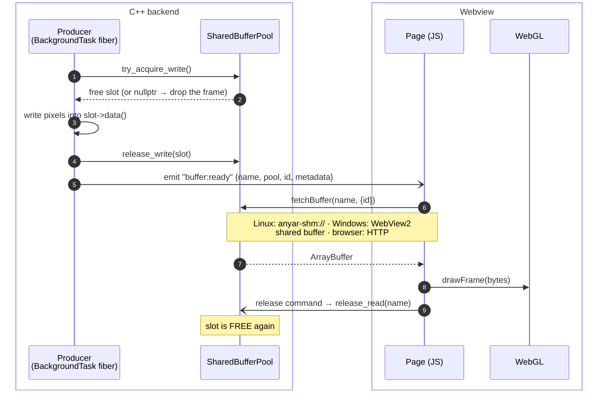
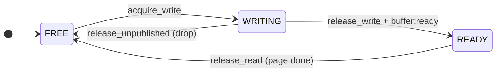

# Shared Memory IPC & WebGL Canvas — Developer Guide

> Zero-copy binary data transfer between C++ and the webview frontend.

## Overview

LibAnyar provides two complementary modules for high-throughput binary data:

| Module | Purpose |
|---|---|
| `@libanyar/api/buffer` | Create, write, fetch, and manage shared memory buffers |
| `@libanyar/api/canvas` | WebGL frame renderer consuming shared buffers (RGBA & YUV420) |

**Use cases:** Video frame streaming, image processing pipelines, LiDAR/point cloud visualization, real-time sensor data, screen capture overlays.

**How it works:**



1. C++ takes a slot from a `SharedBufferPool` (or creates a one-off `SharedBuffer`) and writes into its memory.
2. C++ emits `buffer:ready` with the buffer's name and generation id.
3. JS calls `fetchBuffer()`, which picks the fastest transport for the platform (below).
4. JS draws with WebGL (`FrameRenderer`) or uses the `ArrayBuffer` directly, then releases the slot.

---

## C++ API

> Signatures below match `core/include/anyar/shared_buffer.h`. The working references are `examples/video-player` (streaming pool) and `examples/anatomy-atlas` (one-off buffers).

### SharedBuffer

A named shared memory region. On Linux it is POSIX `shm_open()` + `mmap()`; on Windows it is a WebView2 shared buffer once a window exists (otherwise a pagefile-backed mapping served over HTTP).

```cpp
#include <anyar/shared_buffer.h>

// Create a 1920×1080 RGBA buffer (≈8 MB). Names are process-global, and
// create() registers the buffer so the page can fetch it by name.
auto buf = anyar::SharedBuffer::create("camera-frame", 1920 * 1080 * 4);

std::memcpy(buf->data(), pixels, buf->size());

buf->name();   // "camera-frame"
buf->size();   // 8294400
buf->data();   // uint8_t* into the shared mapping
buf->id();     // generation id — never reused, even for the same name

// Tell the page. fetchBuffer() takes the name; `id` lets it skip revalidation.
app.emit("buffer:ready", {
    {"name", buf->name()}, {"id", buf->id()},
    {"url", "anyar-shm://" + buf->name()}, {"size", buf->size()},
    {"metadata", {{"width", 1920}, {"height", 1080}, {"format", "rgba"}}}
});

// Free it when the page is done (for example from a release command):
anyar::SharedBufferRegistry::instance().remove("camera-frame");
```

### SharedBufferRegistry

Process-wide map from name to buffer. `SharedBuffer::create()` adds to it; the `anyar-shm://` handler, the HTTP fallback and the `buffer:*` commands look buffers up here.

```cpp
auto& reg = anyar::SharedBufferRegistry::instance();
std::shared_ptr<anyar::SharedBuffer> b = reg.get("camera-frame");  // nullptr if absent
std::vector<std::string> names = reg.names();
reg.remove("camera-frame");   // unmapped once the last shared_ptr is gone
```

Memory stays valid while anyone holds the `shared_ptr` — including a fetch in flight — so removing a buffer the page is still reading is safe.

### SharedBufferPool

A ring of N buffers for streaming (video frames, sensor data). Slots are named `<base>_0 … <base>_{N-1}`.

```cpp
// One pool per session, with its own base name (names are process-global).
auto pool = std::make_unique<anyar::SharedBufferPool>("video-" + std::to_string(++session),
                                                      1920 * 1080 * 4, /*count=*/3);

// Producer (a BackgroundTask fiber):
anyar::SharedBuffer* slot = pool->try_acquire_write();   // nullptr = page is behind → drop
if (slot) {
    std::memcpy(slot->data(), frame, slot->size());
    pool->release_write(*slot, "{}");                     // WRITING → READY
    app.emit("buffer:ready", {{"name", slot->name()}, {"pool", pool->base_name()},
                              {"id", slot->id()}, {"url", "anyar-shm://" + slot->name()},
                              {"size", slot->size()}, {"metadata", {{"width", 1920}, {"height", 1080}}}});
}

// Consumer: the page calls your release command once it has drawn the slot:
pool->release_read(name);                                 // READY → FREE

// Shutdown: unblock a producer waiting in acquire_write() (it throws SharedBufferPoolClosed).
pool->close();
```

Use `try_acquire_write()` for live sources: dropping a frame beats stalling the camera. The blocking `acquire_write()` suits producers that must deliver every item, as long as `close()` can wake it at shutdown. `release_unpublished(slot)` returns a slot you filled but decided not to send (seek, error).

**Slot states:**



Transitions are `compare_exchange_strong` on an atomic per slot, so the hot path takes no mutex. A stale or duplicate release never frees a slot the producer is still writing.

---

## JavaScript API — `@libanyar/api/buffer`

### Import

```ts
import {
  createBuffer, writeBuffer, destroyBuffer, listBuffers,
  fetchBuffer, notifyBuffer, onBufferReady,
  createPool, destroyPool, poolAcquire, poolReleaseWrite, poolReleaseRead,
} from '@libanyar/api/buffer';
```

### Buffer Operations

#### `createBuffer(name, size)`
Create a named shared memory buffer on the C++ side.

```ts
await createBuffer('my-frame', 1920 * 1080 * 4);
```

**Parameters:**
| Param | Type | Description |
|---|---|---|
| `name` | `string` | Unique buffer name |
| `size` | `number` | Size in bytes |

**Returns:** `Promise<SharedBufferInfo>` — `{ name, size, url, id? }`

---

#### `writeBuffer(name, data)`
Write binary data to an existing buffer (base64-encoded transfer via IPC).

```ts
const pixels = new Uint8Array(width * height * 4);
// ... fill pixels ...
await writeBuffer('my-frame', pixels);
```

> **Note:** For high-throughput scenarios, prefer writing from C++ directly via `memcpy` to avoid base64 encoding overhead.

---

#### `fetchBuffer(nameOrUrl, options?)`
Fetches a buffer's contents and returns the raw binary data. The transport depends on the platform (see below).

```ts
const data: ArrayBuffer = await fetchBuffer('my-frame');
// or with explicit URL:
const data = await fetchBuffer('anyar-shm://my-frame');

// Access as typed array
const pixels = new Uint8Array(data);
```

**Returns:** `Promise<ArrayBuffer>`

| Option | Default | Meaning |
|---|---|---|
| `copy` | `true` | `true` returns a snapshot. `false` returns the live memory where the platform supports it (Windows), for consumers that read immediately and then release a pool slot. |
| `id` | — | Generation id from a `buffer:ready` payload. On Windows, it skips the attach round trip when the page already holds that generation. |

Transport by platform:

- **Linux:** `fetch('anyar-shm://<name>')`. The scheme handler wraps the mapping in a `GBytes` (`g_bytes_new_with_free_func()`, which keeps the buffer alive until WebKit is done).
- **Windows (WebView2):**
  1. The page calls `buffer:attach {name, have}`.
  2. C++ posts the buffer's own memory with `PostSharedBufferToScript`.
  3. The page caches the `ArrayBuffer` per name and generation.

  Steady-state frames therefore cost no IPC. `copy: false` returns that memory directly (~0.01 ms for 8 MiB), and the default does one in-renderer `slice`.
- **Fallback (both platforms):** `GET /__anyar__/buffer/<name>` over loopback HTTP. On Windows it is used when a buffer was created before any window existed, the runtime is older than 1.0.1661, or the window uses a different WebView2 environment. See [ADR-011](decisions.md).

```ts
// per-frame, zero-copy where supported (pool slot released right after drawing)
onBufferReady(async (e) => {
  renderer.drawFrame(await fetchBuffer(e.url, { copy: false, id: e.id }));
  await poolReleaseRead(e.pool!, e.name);
});
```

---

#### `destroyBuffer(name)`
Unmap and unlink a shared memory buffer.

```ts
await destroyBuffer('my-frame');
```

---

#### `listBuffers()`
List all active buffers.

```ts
const buffers = await listBuffers();
// [{ name: "camera-frame", size: 8294400, url: "anyar-shm://camera-frame" }, …]
```

**Returns:** `Promise<SharedBufferInfo[]>`

---

#### `notifyBuffer(name, metadata?)`
Emit a `buffer:ready` event for a buffer (with optional metadata).

```ts
await notifyBuffer('my-frame', { width: 1920, height: 1080, format: 'rgba' });
```

---

#### `onBufferReady(handler)`
Listen for `buffer:ready` events.

```ts
const unlisten = onBufferReady((event) => {
  console.log(event.name);            // "my-frame"
  console.log(event.pool);            // "video" (pool slots only)
  console.log(event.id);              // generation id → fetchBuffer(name, { id })
  console.log(event.metadata.width);  // whatever the producer put in metadata
});

// Stop listening
unlisten();
```

---

### Pool Operations

#### `createPool(name, bufferSize, count = 3)`
Create a ring buffer pool for streaming. Usually C++ owns its pools; these JS wrappers exist for prototyping and tests.

```ts
const info = await createPool('video', 1920 * 1080 * 4, 3);
// { name: "video", bufferSize: 8294400, count: 3, buffers: [ … ] }
```

---

#### `poolAcquire(poolName)`
Acquire a free slot for writing.

```ts
const slot = await poolAcquire('video');
// { name: "video_0", size: 8294400, url: "anyar-shm://video_0" }
```

**Returns:** `Promise<SharedBufferInfo>`

---

#### `poolReleaseWrite(poolName, bufferName, metadata?)`
Release a slot after writing (WRITING → READY) and emit `buffer:ready` with `metadata`.

```ts
await poolReleaseWrite('video', 'video_0', { width: 1920, height: 1080 });
```

---

#### `poolReleaseRead(poolName, bufferName)`
Give a slot back after reading (READY → FREE). Call it in a `finally`, so a failed draw can't leak a slot. It only finds pools created with `createPool()`; a pool owned by a C++ plugin needs that plugin's own release command.

```ts
await poolReleaseRead('video', 'video_0');
```

---

#### `destroyPool(poolName)`
Destroy a pool and all its shared memory slots.

```ts
await destroyPool('video');
```

---

## JavaScript API — `@libanyar/api/canvas`

### Import

```ts
import {
  FrameRenderer,
  createFrameRenderer,
  createBufferRenderer,
} from '@libanyar/api/canvas';
```

### `createFrameRenderer(options)`

Create a WebGL renderer attached to a canvas element.

```ts
const renderer = createFrameRenderer({
  canvas: document.getElementById('viewport'),  // or CSS selector '#viewport'
  width: 1920,
  height: 1080,
  format: 'rgba',  // 'rgba' or 'yuv420'
});

// Draw a frame from an ArrayBuffer
renderer.drawFrame(frameData);

// Resize (e.g., on window resize)
renderer.resize(1280, 720);

// Cleanup
renderer.destroy();
```

**Options:**

| Option | Type | Default | Description |
|---|---|---|---|
| `canvas` | `HTMLCanvasElement \| string` | — | Target canvas element or CSS selector |
| `width` | `number` | — | Frame width in pixels |
| `height` | `number` | — | Frame height in pixels |
| `format` | `PixelFormat` | `'rgba'` | Pixel format of input data |

**Supported formats:**

| Format | Bytes/pixel | Description |
|---|---|---|
| `'rgba'` | 4 | Standard RGBA — 4 channels, 8 bits each |
| `'rgb'` | 3 | RGB without alpha channel |
| `'bgra'` | 4 | BGRA byte order (common on Windows / Direct3D) — channel-swapped in shader |
| `'grayscale'` | 1 | Single luminance channel (depth maps, thermal) |
| `'yuv420'` | 1.5 | YUV 4:2:0 planar (Y + U + V planes) — BT.601 conversion in shader |
| `'nv12'` | 1.5 | YUV 4:2:0 semi-planar, UV interleaved (hardware decoders, VA-API, NVDEC) |
| `'nv21'` | 1.5 | YUV 4:2:0 semi-planar, VU interleaved (Android cameras) |

### `FrameRenderer` Methods

| Method | Description |
|---|---|
| `drawFrame(data: ArrayBuffer)` | Upload and render a frame |
| `resize(width, height)` | Update dimensions and viewport |
| `destroy()` | Release WebGL resources |

---

### `createBufferRenderer(options)`

Convenience function that combines shared memory fetching with WebGL rendering. It listens for `buffer:ready` events from one pool, draws each frame, and releases the slot.

```ts
const { destroy } = createBufferRenderer({
  canvas: '#viewport',
  width: 1920,
  height: 1080,
  format: 'rgba',
  pool: 'video-frames',   // required: only this pool's frames are drawn
});

// Rendering happens automatically on buffer:ready events
// Call destroy() to stop
destroy();
```

**Additional options:**

| Option | Type | Default | Description |
|---|---|---|---|
| `pool` | `string` | — | Pool whose `buffer:ready` events are drawn |
| `autoRelease` | `boolean` | `true` | Call `poolReleaseRead()` after each frame (in a `finally`). That built-in command only knows pools made with `createPool()` / `buffer:pool-create`; for a pool your C++ plugin owns, set `false` and call your plugin's release command (example below) |
| `onFrame` | `(event) => void` | — | Called after each frame is drawn |

If a frame's `metadata.width`/`height` differ from the options, the renderer resizes itself.

---

## Complete Example — Video Frame Streaming

### C++ Side (Producer)

A plugin that owns a pool and a producer loop. The loop is an `anyar::BackgroundTask`, so `shutdown()` can stop and join it (see [graceful-shutdown.md](graceful-shutdown.md)).

```cpp
#include <anyar/plugin.h>
#include <anyar/shared_buffer.h>
#include <anyar/task.h>
#include <libasyik/service.hpp>
#include <cstring>

class FramesPlugin : public anyar::IAnyarPlugin {
public:
    std::string name() const override { return "frames"; }

    void initialize(anyar::PluginContext& ctx) override {
        service_ = ctx.service;
        events_ = &ctx.events;
        pool_ = std::make_unique<anyar::SharedBufferPool>("video", W * H * 4, 3);

        ctx.commands.add("video:start", [this](const anyar::json&) -> anyar::json {
            if (loop_.running()) return {{"status", "running"}};
            loop_.start(service_, [this](anyar::StopToken st) {
                for (int frame = 0; !st.stop_requested(); ++frame) {
                    anyar::SharedBuffer* slot = pool_->try_acquire_write();
                    if (slot) {                                    // else: page is behind, drop
                        generate_frame(slot->data(), slot->size(), frame);   // your renderer
                        pool_->release_write(*slot, "{}");
                        events_->emit("buffer:ready", {
                            {"name", slot->name()}, {"pool", pool_->base_name()},
                            {"id", slot->id()}, {"url", "anyar-shm://" + slot->name()},
                            {"size", slot->size()},
                            {"metadata", {{"width", W}, {"height", H}, {"format", "rgba"}}}});
                    }
                    asyik::sleep_for(std::chrono::milliseconds(33));   // ~30 fps, yields the fiber
                }
            });
            return {{"status", "started"}};
        });
        // The page gives each slot back after drawing it.
        ctx.commands.add("video:frame-done", [this](const anyar::json& a) -> anyar::json {
            pool_->release_read(a.at("name").get<std::string>());
            return {{"ok", true}};
        });
    }

    void shutdown() override {     // UI thread; the service thread is still running
        loop_.stop();              // request + join
        pool_->close();
    }

private:
    static constexpr int W = 1280, H = 720;
    asyik::service_ptr service_;
    anyar::EventBus* events_ = nullptr;
    std::unique_ptr<anyar::SharedBufferPool> pool_;
    anyar::BackgroundTask loop_;
};

int main() {
    anyar::App app;
    app.use(std::make_shared<FramesPlugin>());
    app.create_window({.title = "Video Viewer", .width = 1280, .height = 720});
    return app.run();
}
```

### JavaScript Side (Consumer)

```html
<canvas id="viewport" width="1280" height="720"></canvas>

<script type="module">
import { createFrameRenderer } from '@libanyar/api/canvas';
import { fetchBuffer, onBufferReady } from '@libanyar/api/buffer';
import { invoke } from '@libanyar/api';

const renderer = createFrameRenderer({ canvas: '#viewport', width: 1280, height: 720, format: 'rgba' });

onBufferReady(async (e) => {
  if (e.pool !== 'video') return;
  try {
    renderer.drawFrame(await fetchBuffer(e.name, { copy: false, id: e.id }));  // live view where supported
  } finally {
    await invoke('video:frame-done', { name: e.name });                         // always give the slot back
  }
});

await invoke('video:start');
</script>
```

For a pool created from JS with `createPool()`, `createBufferRenderer({ canvas, width, height, format, pool })` does all of this in one call.

---

## Performance Notes

> ⚠️ **Measured vs. design estimates.** The tables below are original design estimates. Measured on WebKitGTK 2.50 ([benchmarks/README.md](../benchmarks/README.md), 2026-09-24): a 1080p RGBA `fetch('anyar-shm://…')` takes **~21 ms** (not ~0.05 ms); the HTTP fallback ~25 ms. Root cause: WebKit streams custom-URI-scheme responses to the WebProcess in fixed 8 KB chunks (one IPC each), and JSC forbids true zero-copy `ArrayBuffer`s (Gigacage). A WebProcess-extension prototype (one memcpy) reaches ~0.4 ms but is not shipped yet. For 1080p60 today, prefer [Pinhole](pinhole-rendering.md) (~0.7 ms CPU/frame measured).

| Metric | Value (estimate) | Notes |
|---|---|---|
| Buffer creation | ~0.1ms | One-time `shm_open()` + `mmap()` |
| Frame write (C++) | ~0.3ms (1080p RGBA) | `memcpy` to mmap'd memory |
| Frame fetch (JS) | ~0.05ms | `anyar-shm://` URI scheme, zero-copy via `g_bytes_new_with_free_func()` |
| Event notification | ~0.01ms | Native IPC push via `webview_eval()` |
| WebGL upload + render | ~0.5ms (1080p) | `texImage2D` + draw call |
| **Total pipeline** | **~1ms per frame** | C++ write → JS fetch → WebGL render |

### Comparison with Alternatives

| Approach | Latency | Copy Count | Max Throughput |
|---|---|---|---|
| Base64 via JSON IPC | ~15ms (1080p) | 3 copies | ~10fps |
| HTTP POST binary | ~5ms (1080p) | 2 copies | ~30fps |
| WebSocket binary | ~3ms (1080p) | 2 copies | ~60fps |
| **Shared Memory (LibAnyar)** | **~1ms (1080p)** | **0-1 copies** | **120fps+** |

---

## Platform Support

| Platform | Backend | Status |
|---|---|---|
| Linux | POSIX `shm_open()` + WebKitGTK `anyar-shm://` | ✅ Implemented |
| Windows | WebView2 shared buffer (`CreateSharedBuffer` → `PostSharedBufferToScript`, pulled by `buffer:attach`); file mapping + HTTP fallback | ✅ Implemented ([ADR-011](decisions.md)) |
| macOS | `shm_open()` + WKWebView URL scheme | 🔲 Planned |

---

## Testing

The shared memory IPC has comprehensive test coverage:

- **Unit tests** (`test_shared_buffer`) — 17 Catch2 test cases, 552 assertions covering SharedBuffer, Registry, and Pool
- **WebGL E2E test** (`test_webgl_canvas`) — Automated in-webview pixel verification: creates a 4×4 RGBA buffer with known pattern, renders via WebGL, reads back pixels with `gl.readPixels()`, verifies all 16 pixels match (±2 tolerance)

Run all tests:
```bash
cd build && ctest --output-on-failure
```

Run only shared memory tests:
```bash
ctest -R "shared_buffer|webgl"
```
