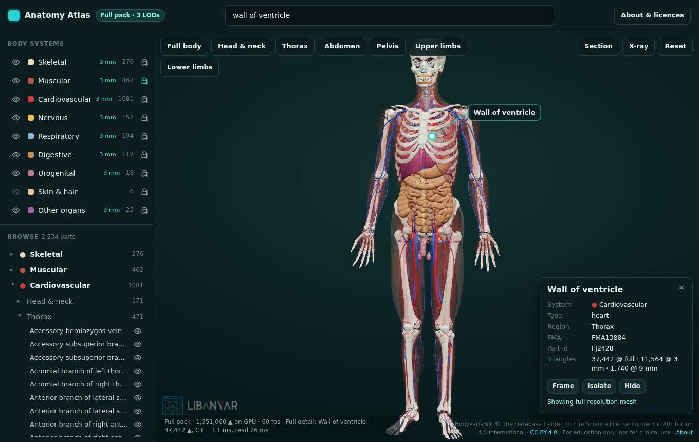

# LibAnyar — Anatomy Atlas Example

A whole-body 3D anatomy explorer: 2,234 FMA-labelled structures from [BodyParts3D](https://dbarchive.biosciencedbc.jp/en/bodyparts3d/) (skeleton, muscles, vessels, nerves, brain, organs, skin) with body-system layers, search, a browsable tree, click-to-identify, isolate, X-ray and cross-sections.

> **For education and demonstration only.** This is not a medical device; do not use it for diagnosis or treatment.
>
> Anatomy data: **BodyParts3D, © The Database Center for Life Science licensed under CC Attribution 4.0 International** — see [assets/bodyparts3d/README.md](assets/bodyparts3d/README.md). The data is not covered by LibAnyar's MIT licence.



## What it demonstrates

- **Streaming large geometry from C++ to WebGL.** The C++ `AtlasPlugin` decodes the anatomy pack and builds one merged mesh per body system. Each mesh is handed over as **one SharedBuffer** (positions, normals, per-vertex part ids, indices), so vertex data never goes through JSON. The frontend wraps typed-array views around the bytes and releases the buffer as soon as the GPU has it.
- **Level-of-detail streaming.** Every system first arrives at 9 mm, so there's a picture within a second. Then the 3 mm level streams in behind it, and selecting a part streams that part's full-resolution mesh. Decoding runs on the worker pool (`anyar::run_blocking`) and loads are serialised, so memory stays bounded and IPC stays responsive.
- **Fast native search.** `atlas:search` ranks names, FMA IDs and part ids in C++ (well under 1 ms). It also matches each part's type, system and region, so "heart" finds the chambers and valves.
- **GPU-side state.** Visibility, X-ray and highlight for all 2,234 parts live in a small state texture. Showing, hiding or isolating a part is one texture write, and the scene is ~9 draw calls rather than 2,234. Clicks are resolved with GPU picking (part ids rendered into a 1×1 target). Cross-sections get solid caps through stencil passes.
- **Licence-aware assets.** The pack ships with a `MANIFEST.json` and `LICENSE`. The app builds its credit line and About dialog from the manifest, and CI's licence gate (`scripts/check_assets.py`) checks the folder.

## Data: sample vs full pack

| Pack | Detail | Size | Where |
|---|---|---|---|
| Sample (default) | all parts at 12 mm, ≈253k triangles | 2.8 MB | `assets/bodyparts3d/sample.pack`, embedded in the binary |
| Full | three LODs: source mesh (6.7M ▲), 3 mm (1.7M ▲), 9 mm (0.4M ▲) | 90 MB | GitHub Release asset `anatomy-bodyparts3d-v1`, never in Git |

The app picks, in order:
1. `$ANATOMY_PACK`;
2. `anatomy/bodyparts3d-full.pack` next to the working directory or the executable;
3. the embedded sample.

## Build & run

```bash
cd examples/anatomy-atlas/frontend
npm install && npm run build
cd ../../..
cmake -B build -DANYAR_BUILD_TESTS=ON              # sample pack only
cmake -B build -DANYAR_FETCH_ANATOMY=ON            # + download the full pack (SHA-256 checked)
cmake -B build -DANYAR_ANATOMY_PACK=/path/bodyparts3d-full.pack   # or use a local copy
cmake --build build --target anatomy_atlas -j4
./run.sh build/examples/anatomy-atlas/anatomy_atlas
ctest --test-dir build -R atlas --output-on-failure
```

Re-run `cmake -B build` after each frontend build, so the embedded file list picks up the new hashed file names.

Environment variables:

| Variable | Effect |
|---|---|
| `ANATOMY_PACK=/path/x.pack` | Use this pack |
| `ATLAS_PORT=3080` | Fixed HTTP port (opens the same UI in a browser) |
| `ATLAS_DEBUG=1` | DevTools, plus a log line per streamed buffer |

## IPC

| Command | Args | Returns |
|---|---|---|
| `atlas:info` | — | pack kind/path, part count, LODs (`lods_mm`), body height, systems, `source` (licence + attribution), `manifest` |
| `atlas:parts` | — | `{ fields[], parts[][] }`: id, FMA, name, system, kind, region, bounds, triangles per LOD |
| `atlas:search` | `{ q, limit? }` | `{ results: partIndex[], ms }` |
| `atlas:load` | `{ system, lod }` | geometry meta: `buffer`, `id`, `bytes`, `vertices`, `triangles`, `ms`, `layout{positions, normals, part, indices}` |
| `atlas:load_parts` | `{ parts[], lod }` | geometry meta (e.g. full detail for the selection) |
| `atlas:release` | `{ buffer }` | `{ ok }`; frees the SharedBuffer once the frontend has uploaded it |

Event: `atlas:progress` (`{ stage, p }`).

## Using it

- **Body systems:** use the eye icon to show or hide a system, and the ghost icon to make it see-through.
- **Search:** type a name (`left femur`), a type (`artery`), a region (`upper limb`) or an id (`FMA7088`), then press Enter to jump to the top result.
- **Selecting a part:**
  - Click a part to select it: it gets a label on its surface, an info card, and its full-resolution mesh.
  - Double-click a part to frame it.
  - From the card, you can **Isolate** (everything else turns to ghost), **Hide** or **Frame** the part.
- **Region buttons** frame the head, thorax, abdomen, pelvis or limbs.
- **Section:** pick the sagittal, coronal or transverse plane, drag the slider, or Flip to keep the other side. The cut is capped, and the camera turns to face it.
- **X-ray** ghosts everything except the selection.

## Debugging and automated testing

The atlas is the showcase for LibAnyar's [debugging tools](../../docs/debugging.md):

```bash
ANYAR_CONSOLE=1 ./run.sh build/examples/anatomy-atlas/anatomy_atlas          # page console in the terminal
xvfb-run -a env ANYAR_TEST_SCRIPT=examples/anatomy-atlas/test/smoke.js ANYAR_TEST_TIMEOUT=120 \
    ./build/examples/anatomy-atlas/anatomy_atlas; echo "exit $?"            # scripted UI test in the real webview
```

`test/smoke.js` waits for the anatomy to stream in, then:
1. takes a screenshot of the real WebKitGTK rendering (WebGL included);
2. types "left femur" into search with real key events and presses Enter;
3. checks the selection, toggles the section and X-ray tools, and takes another screenshot;
4. exits with code 0.

On platforms without synthetic input yet, it falls back to DOM events.

## Performance (2026-10-21, see `benchmarks/README.md`)

The whole body at 3 mm (every system, 1.69M triangles) holds **60 fps (vsync)**. This was measured both on an AMD Radeon 780M integrated GPU and on an RTX 4050, in headless Chrome over ANGLE at 1060×800. C++ decode (Debug build, `-O2` on the decoder) takes 0.2–14 ms per system at 3 mm, 125 ms for the muscles (751k ▲), and 339 ms for all muscles at full resolution (2.5M ▲). Reading a SharedBuffer takes 3–40 ms per buffer.

## Rebuilding the packs

See [assets/bodyparts3d/README.md](assets/bodyparts3d/README.md). `tools/build_atlas_pack.py` is pure Python and deterministic. It:
- classifies each part into a body system from BodyParts3D's is-a / part-of lists, with name-keyword fallbacks;
- assigns a region from the part's position;
- simplifies by vertex clustering and quantises positions to 16 bits;
- writes a provenance manifest.
