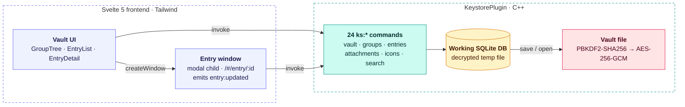

# Key Storage Example

A KeePass-like encrypted password manager built with LibAnyar — demonstrating custom plugins, SQLite, and AES-256-GCM encryption.

## Features

- **Encrypted file format** (`.anyarks`) with AES-256-GCM + PBKDF2 key derivation
- **In-memory SQLite** — database is decrypted into RAM, never stored on disk unencrypted
- **Group hierarchy** — tree-based organization with drag-and-drop
- **Entry management** — title, username, password, URL, notes, custom fields
- **File attachments** — binary data stored as base64 in the database
- **Custom icons** — per-entry SVG/PNG icons
- **Dark theme UI** — shadcn-inspired Svelte 5 components
- **Native app feel** — no right-click, no zoom/pinch, viewport locked

## Architecture



## Commands (24 total)

| Category | Commands |
|----------|----------|
| **Lifecycle** | `ks:new`, `ks:open`, `ks:save`, `ks:close`, `ks:lock`, `ks:change_password` |
| **Groups** | `ks:groups`, `ks:create_group`, `ks:rename_group`, `ks:delete_group`, `ks:move_group` |
| **Entries** | `ks:entries`, `ks:get_entry`, `ks:create_entry`, `ks:update_entry`, `ks:delete_entry`, `ks:move_entry` |
| **Attachments** | `ks:add_attachment`, `ks:get_attachment`, `ks:delete_attachment` |
| **Icons** | `ks:set_icon`, `ks:get_icon` |

## File Format (.anyarks)

```
Offset  Size  Description
0       8     Magic: "ANYARKS\0"
8       4     Version (uint32 LE)
12      4     PBKDF2 iterations (uint32 LE)
16      32    PBKDF2 salt
48      12    AES-GCM IV/nonce
60      16    AES-GCM authentication tag
76      4     Encrypted payload length (uint32 LE)
80      ...   Encrypted SQLite database
```

## Project Structure

```
key-storage/
├── CMakeLists.txt
├── src-cpp/
│   ├── main.cpp               # App entry + window config
│   ├── keystore_plugin.h      # Plugin header (crypto + DB)
│   └── keystore_plugin.cpp    # Plugin implementation (~965 lines)
└── frontend/
    ├── package.json            # Svelte 5 + Tailwind CSS 4
    ├── vite.config.js
    ├── index.html
    └── src/
        ├── main.js
        ├── app.css             # Dark theme + shadcn buttons
        ├── App.svelte          # Main app layout
        ├── lib/
        │   ├── GroupTree.svelte    # Tree view with context menu
        │   ├── EntryList.svelte    # Entry list with search
        │   ├── EntryDetail.svelte  # Entry edit form
        │   ├── UnlockDialog.svelte # Master password dialog
        │   └── Toolbar.svelte      # File operations toolbar
        └── ...
```

## Building

```bash
# Build frontend
cd examples/key-storage/frontend
npm install && npm run build

# Build C++ (from libanyar/build)
make key_storage -j$(nproc)
```

## Running

```bash
cd build/examples/key-storage
bash ../../../run.sh ./key_storage
```

> The `run.sh` script cleans snap GTK environment variables that can interfere with WebKitGTK.

## Security Notes

- The master password is never stored — only the derived key is held in memory while the database is open
- PBKDF2 uses 100,000 iterations with a 32-byte random salt
- AES-256-GCM provides both encryption and authentication
- The temporary SQLite file is overwritten and deleted on close
- `debug = false` disables DevTools access in the shipped app
